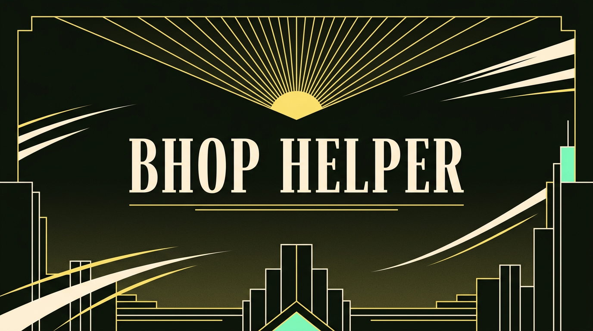

<p align="center">
  
</p>

# Deadlock :: Bhop Trainer — тренажёр с подсказками

Файл-помощник для тренировки банихопа, air strafe и техник движения в Deadlock.
В игре по нажатию клавиши показывает **что и когда нажимать**, плюс умеет выводить твою скорость на экран.

**Это не чит.** Никакой автоматизации ввода: файл только печатает текст и вешает обычные бинды. Все кнопки ты жмёшь руками.

**Оформление — по палитре самой игры.** Цвета взяты из `citadel_base_styles.css` самого Deadlock:
кремовый `#FFEFD7`, золото `#FFED79`, soul-зелёный `#70F8C1`, фон `#10130D`.
Панель на экране — ар-деко: золотые хайрлайны, ромбовидные разделители, разреженные капители.

Полноценное визуальное превью (с интерактивом: `J` / `H` / `M`) — `preview/bhop-hud-preview.html`.
Настоящая панель поверх игры (панорама-аддон) — в соседней папке `../bhop-hud-mod/`.

---

## Что внутри

| Файл | Назначение |
|---|---|
| `bhop_helper.cfg` | Основной помощник v2: русские подсказки + оформление в стиле игры |
| `bhop_helper_latin.cfg` | То же самое латиницей — если консоль не переваривает кириллицу и вместо букв `?????` |
| `bhop_helper_off.cfg` | Полное выключение: снимает бинды, убирает панель, возвращает цвет консоли |
| `install.bat` / `install.ps1` | Однокнопочная установка на Windows: находит Deadlock в Steam, копирует `.cfg`, предлагает настроить автозагрузку |
| `preview/bhop-hud-preview.html` | Браузерное превью дизайна: те же шаги, палитра и спидеометр |
| `docs/banner.png` | Обложка в ар-деко стиле игры |

---

## Установка (30 секунд)

### Windows — автоматически

1. Закрой Deadlock, если игра запущена.
2. Дважды щёлкни **`install.bat`** в этой папке (`bhop-trainer`). Установщик сам ищет игру в Steam и её библиотеках; если не найдёт — попросит указать папку Deadlock.
3. Он скопирует три `.cfg` в `game\citadel\cfg`, сохранив резервные копии уже существующих файлов. Затем предложит включить автозагрузку через `autoexec.cfg` — нажми Enter для ответа «да» или `n`, чтобы пропустить.
4. Запусти Deadlock. Если автозагрузку пропустил: включи консоль в настройках игры (Options → Enable Console), нажми **F7** и введи `exec bhop_helper.cfg`.

Установщик не требует Python и ставит **только cfg-помощник** — он не устанавливает Panorama HUD-аддон/VPK и не меняет `hud.xml`.

### Linux / Proton или вручную

Из корня репозитория можно запустить:

```bash
python3 bhop-hud-mod/tools/install_dmm.py cfg
```

Или скопировать `.cfg` вручную в `...\Deadlock\game\citadel\cfg\`, затем в консоли игры выполнить `exec bhop_helper.cfg`.

---

## Клавиши

| Клавиша | Что делает |
|---|---|
| **J** | Следующая подсказка. Цикл 1 → 8 → 1, каждая ступень = конкретное упражнение с тем, что нажимать |
| **H** | Весь чек-лист сразу: цифры (700/900 u/s, 450, 376, слайд > 0.5 с) и порядок обучения |
| **M** | Вкл/выкл показ скорости (`cl_showpos`). Смотри значение **vel** — это твоя текущая скорость |
| **F8** | Перезагрузить помощник |
| **F9** | Выключить помощник (снимает бинды и текст с экрана) |

Клавиши заняты чем-то другим — открой `.cfg`, в разделе 5 «БИНДЫ» поменяй буквы и снова сделай `exec`. Это обычные бинды, их можно вешать куда угодно.

---

## Ступени подсказок (что показывает J)

Панель в игре выглядит так: шапка `DEADLOCK :: BHOP TRAINER` + номер шага, крупный заголовок
шага, золотой разделитель с ромбом, строки «ключ → действие» и подвал с клавишами.

1. **Air strafe** — в воздухе отпусти W, держи A/D, плавно веди мышь туда же.
2. **Круг** — разгон до ~300 и удержание страфа по кругу, контроль по `vel`.
3. **Змейка** — смена стороны страфа каждым прыжком.
4. **Смена страфа внутри прыжка** — сначала клавиша, потом (позже) камера.
5. **Slide hop** — Ctrl держать → прыжок, слайд дольше 0.5 с, скорость выше ~376 u/s.
6. **Raw hop** — прыжок в кадр касания земли, буфер прыжка при пустой стамине.
7. **Dash jump** — даш → прыжок через ~0.2 с (синяя вспышка стамины) → слайд.
8. **Fast climb / corner boost** — W + два прыжка у стены, прыжок от угла.

---

## Цвет панели

В начале `bhop_helper.cfg` стоит строка:

```
log_color Console FFED79FF
```

Это золото Deadlock. Если захочешь другой оттенок — подставь свой HEX (последние две цифры — альфа):

| Цвет | Значение |
|---|---|
| золото (по умолчанию) | `FFED79FF` |
| soul-зелёный | `70F8C1FF` |
| кремовый (базовый текст игры) | `FFEFD7FF` |
| цвет врага | `FF410DFF` |

Если игра не знает команду `log_color` — строка просто ничего не сделает, панель останется стандартного цвета.
При выключении (`bhop_helper_off.cfg`) цвет возвращается в белый.

---

## Честные ограничения

- **Подсказки по нажатию, а не по событию.** `cfg` не имеет доступа к состоянию игры: он не знает, что ты только что приземлился. Поэтому подсказка показывается по твоей клавише, а не «в нужный кадр». Единственная живая телеметрия, которая доступна легально, — `cl_showpos` со скоростью (`vel`).
- **Сделать помощника, который сам нажимает прыжок в кадр приземления, средствами мода нельзя.** Движение считает сервер, а работающий «авто-прыжок» — это внешний макрос/скрипт, то есть чит. За такое в Valve-играх банят, и я такое не собираю.
- **`sv_cheats 1` и `cl_showpos`** работают в лобби/песочнице/Explore Map, но не на официальных матч-серверах. Сами подсказки (текст) — клиентские, они будут работать и в матче, но тренироваться всё равно лучше в песочнице.

---

## Куда идти после подсказок

- **Sandbox во время поиска игры** — практика, пока идёт очередь: включи в настройках/консоли песочницу и бесконечную стамину.
- **Explore Map** (Play → Explore Map) — свободный бег по настоящей карте, идеально для маршрутов.
- **Community jump-карты** — самое близкое к «моду-тренеру»: готовые карты-испытания, ставятся через мод-менеджер, играются в кастомном лобби.
- Полный текстовый разбор механики с цифрами — в `bhop-practice.md` (в этой же папке).

---

## Если что-то не работает

| Симптом | Решение |
|---|---|
| Вместо русских букв `?????` | Используй `bhop_helper_latin.cfg` |
| Текст не виден на экране, виден только в консоли | Попробуй в разделе 1 поменять `con_filter_enable 1` на `con_filter_enable 2`, затем `exec` заново |
| Экрана заполнил другой отладочный текст | `con_filter_text "BHOP>"` должен это убирать; проверь, что строка не изменена |
| Клавиша J/H/M делает что-то другое | Поменяй буквы в разделе 5 «БИНДЫ» |
| Ничего не изменилось после exec | Проверь, что файл лежит именно в `game\citadel\cfg\`, и что консоль отвечает на другие команды |
| Хочу вернуть как было | F7 → `exec bhop_helper_off.cfg` |
